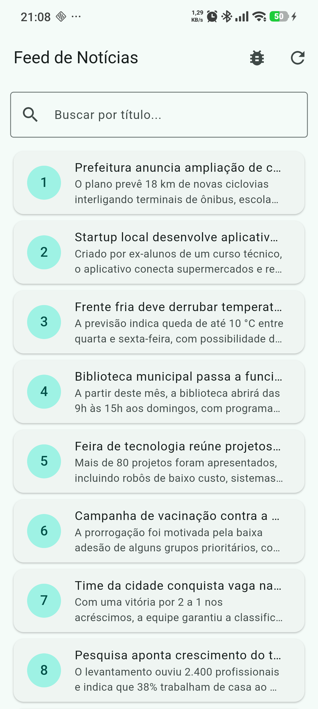
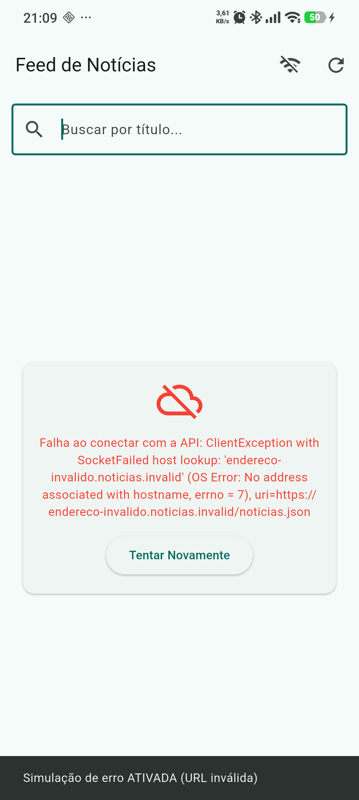

# PDM I — Aula 10: Consumo Avançado de APIs, Listas e Exceções

Aplicativo Flutter que consome um feed de notícias em JSON, exibe os itens com `ListView.builder` e trata os 4 estados da interface: **Carregando**, **Sucesso**, **Vazio** e **Erro de Conexão**.

**Disciplina:** Programação para Dispositivos Móveis I — Prof. Diego Menegassi — 2026/2

## Conceitos aplicados

| Conceito | Implementação |
|---|---|
| Iteração de lista JSON | `jsonDecode()` → `List.map()` → `NoticiaModel.fromJson` |
| Renderização eficiente | `ListView.builder` com `Card` + `ListTile` |
| Validação de StatusCode | `if (response.statusCode == 200)` |
| Tratamento de exceções | `try / catch / finally` no serviço e na tela |

## Desafios implementados

- **Básico — Filtro de busca local:** `TextField` no topo filtra as notícias por título em tempo real.
- **Intermediário — Navegação para detalhes:** tocar em um card abre a tela de detalhes com `Navigator.push`.
- **Avançado — Simulação de erro de conexão:** botão na AppBar alterna a URL para um endereço inválido, exibindo o card de erro com o botão "Tentar Novamente".

## Capturas de tela

| Feed | Busca | Detalhes | Erro de conexão |
|:---:|:---:|:---:|:---:|
|  |  |  |  |

## Estrutura

```
lib/
├── main.dart
├── models/noticia_model.dart
├── services/noticia_service.dart
└── screens/
    ├── feed_noticias_screen.dart
    └── detalhe_noticia_screen.dart
api/noticias.json   # feed de notícias consumido pelo app
```

## Como executar

```bash
flutter pub get
flutter run
```
